# Doors

Doors plans a drink brand's first days in a new city: it ranks the city's bars and restaurants for your drinker on
Qloo's taste graph, routes the open ones, drafts what to say at each door, and re-plans as you check them off.
A map shows every bar; menu-data tools show who already pours your category; only Qloo's graph says which doors are
full of your drinker before anyone pours you, and Doors turns that into the days a rep walks. In the demo, Nomadic Beerworks is Austin's best door for an Athletic Brewing drinker
(#1 of 55), while popularity alone puts it #17 (`SUBMISSION.md` has the 12-scenario test: a blind
screen preferred Doors over the same app with its cultural inputs off in 12 of 12; against a plain popularity list it
is even: scored Doors higher in 10 of 24 asks, the list in 9, 5 ties).

Live demo: **https://doors.oldjard.workers.dev**. Click **Watch the tour**: a guided tour of the real app in 22 short cards, no sign-up.
"Start my profile" plans your own days: any brand Qloo knows, in any US city.

A founder or sales lead at an emerging NA beer, RTD, craft spirits or functional-drink brand (or the distributor rep
carrying it) says what they make and what it comes in, which brands their drinker already buys, the ask they'll make
at each door (Doors suggests one from the product), the city, where their day starts and the hours they have. The
brand is entered once; each city gets its own days and plan (Menu → Settings → My cities). An optional age range for
their drinkers ranks the doors Qloo scores for that age group first. Doors asks Qloo's taste graph which bars and restaurants in that city have regulars who drink like
their drinker and puts them on **Your list**, best first. Then it plans each day as a driving loop from their
start and back, driving first: a door is worth about 15 minutes of extra driving to that loop, more for a top-ranked
door, and every door is open when they arrive. "Most doors a day" (in each city's settings) caps a day if they want fewer. At each door:
why this door, a drafted message, talking points, then a check-off with an outcome. Missed doors roll into later days; a
follow-up schedules a return.

While the rep works the days, **Doors Agent**, a chat on the plan, answers from the plan's own data with a source on every fact
and acts through 13 code-checked tools (explain, compare, ask about the city, re-plan, edit a talking point, log a
visit, save a note, brief a door, prep the day, draft a follow-up, what to bring, plan the next trip, remember a
correction). It runs on Anthropic's Claude Haiku, with Claude Sonnet and web search for a door's menu, events or news
(the pages it used are linked), then Workers AI's Llama 3.3, then Gemini's free tier, then Doors' own rules. **Drive
mode** turns the day into one door at a time and one big Log visit: say how it went, Doors reads it back, files it and moves
on. A return visit greets the person she met; **Your rules** ("never say cooler") hold on every stop. Every input that
shapes a decision has a source and an authority order (your correction > what you told Doors > what you did > Qloo's
data > a guess > Doors' template), and a proof harness (`node scripts/proof.mjs`) checks it on 12 scenarios offline;
`SUBMISSION.md` has the numbers and what is still untested.

Doors finds the doors whose regulars drink like yours, whether or not they pour you yet. It is not a distribution
check: Qloo doesn't know what a door stocks.

Built for the Qloo Agentic Hackathon. MIT licence.

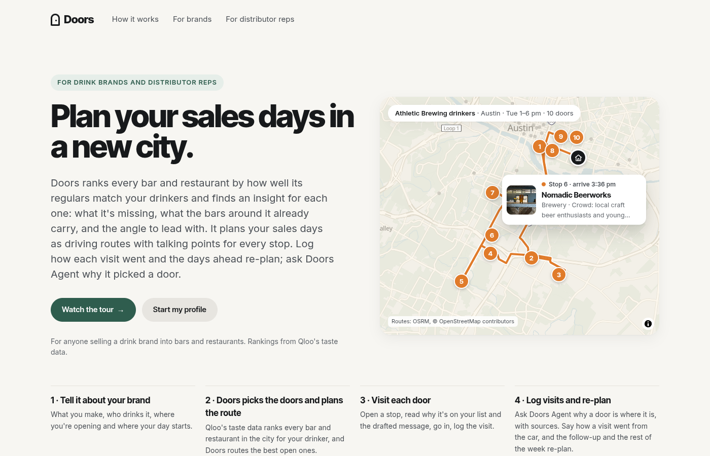

## Sixty seconds for a judge

1. **Watch the tour →** on the landing page: a guided tour of the real app, one card per step (Continue, or do the
   click yourself). Maya Ortiz and her brand Tidewell (a non-alcoholic hazy IPA) are made up for the demo; every venue
   is real. Her profile fills the real form, Build my plan ranks Austin for Athletic Brewing drinkers and routes
   Tuesday on real roads (10 doors, 19 road mi), All days shows three loops (Tue 10, Wed 6, Thu 6 doors; her contact
   BBG's lands on Thursday, the only day it's open), she opens Nomadic Beerworks (#1 of 55), reads the note, why the
   door fits and what to say, logs the visit (Interested, follow up Thursday), and the days ahead re-plan: Tuesday
   re-routes from Nomadic and Thursday gains the return visit. Along the way it asks Doors Agent why the #1-ranked door is stop
   6 (the answer's sources open) and to shorten an opener, starts the day in drive mode and logs a visit in words
   ("done, liked it, come back <date> at 3, hesitant about price") read back before it saves, and ends on the same
   brand in Boise. The tour's plan is baked (no Qloo, routing or plan-building call), but Doors Agent and the voice are
   live, as in the app: Claude answers the chat, and drive mode's hands-free bar listens and speaks. "Skip to the
   finished plan" is in the banner.
2. **Start my profile** on the hand-off opens the form. **Try an example** at the top fills it in one click: a
   made-up rep for each brand Doors already holds (Athletic Brewing, Casamigos, Don Julio, Espolòn, Teremana, Liquid
   Death, LaCroix, White Claw), each in a city it holds (Austin, Chicago, Boise, Omaha). **Build my plan** is instant.
   Then try your own: search any brand and pick it, type any city ("Nashville, TN"), type an address or drop a pin for
   your start, pick your days, and Build. Doors' agent asks Qloo live (about 35 calls, its steps on screen, about 20
   seconds), and the plan works like the examples. A brand and city someone has already run open at once.
3. On the plan: open a stop, try **All days** and **Your list** (every ranked door, best first, with where it landed or
   why it didn't), set **Most doors a day** (Menu → Settings → My cities → Edit), mark a door **Not a fit** (a stop's ⋯ menu) and watch the later days re-plan (Undo puts
   it back), read **Market** (what the plan is based on), open **My doors** (every door you've touched), and from the **Menu** (top right; ☰ on the phone) export the plan, the notes or a printable call sheet.
4. **Doors Agent** (the plan's header; on a phone or a narrow window, the button in the bar at the bottom): "why is my first stop first?", "I have to finish by 5pm", "skip the next one",
   "done at <stop>, back Thursday at 3, liked it". **Start my day** opens drive mode (best on a phone; voice in Chrome
   and Safari). In **Edit my brand** (Menu → Settings), **Your rules** keeps a word out of every note and talking point for the brand.
5. **The iPhone app** (`app-mobile/`) is the whole app, native: the same screens, the web's own planner code and the
   same Worker. It isn't in the App Store, so a judge sees it in the picture below; everything in it also works on the
   web.

| | |
|---|---|
|  | 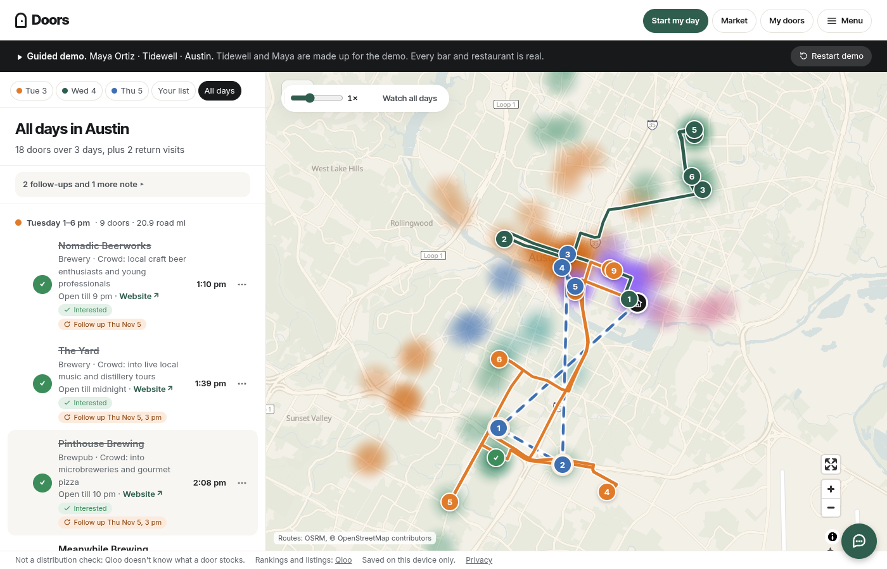 |
| 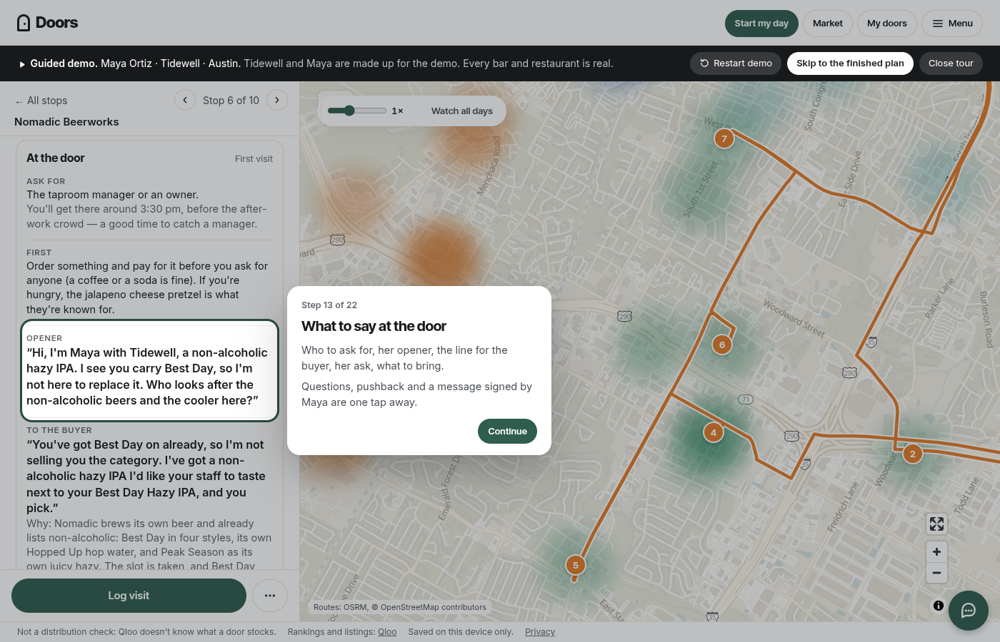 | 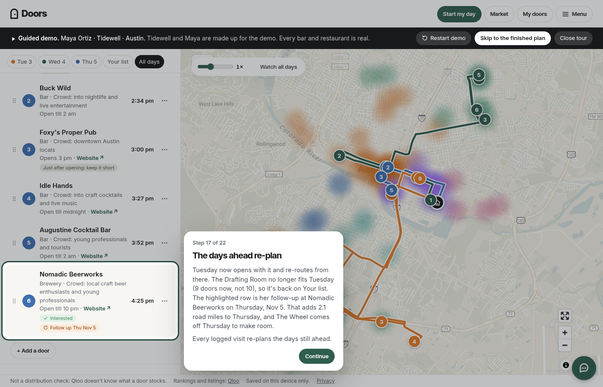 |
| 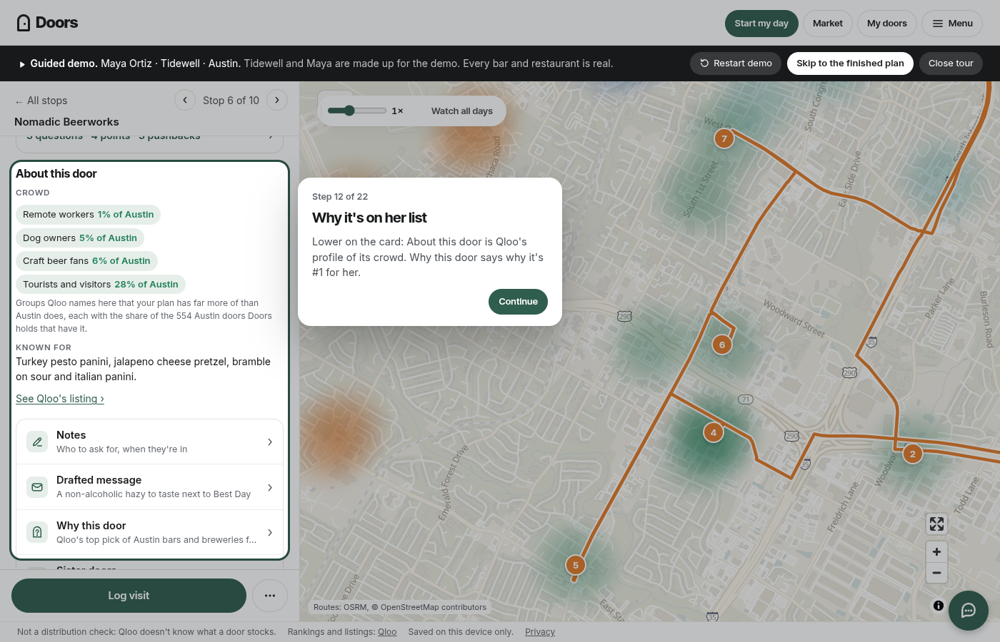 | 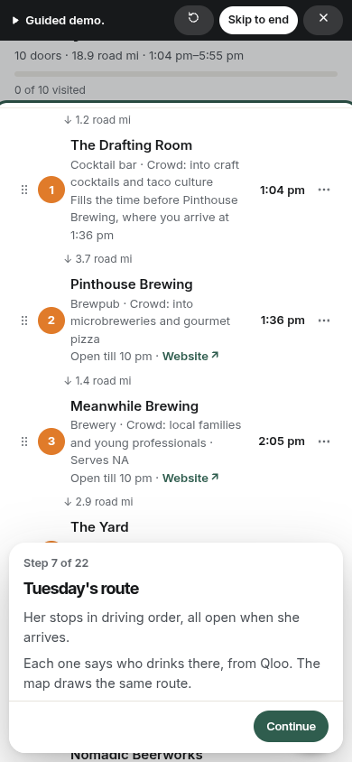 |
|  | 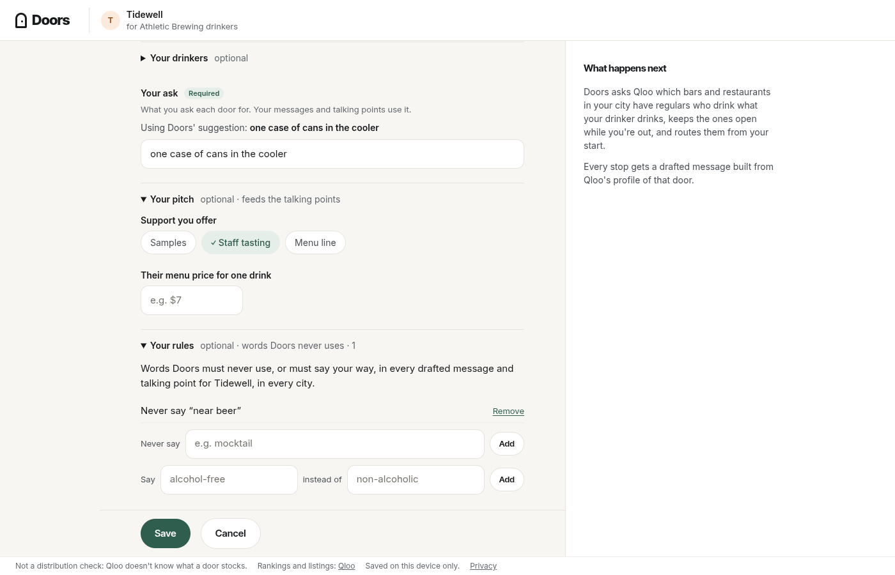 |
| 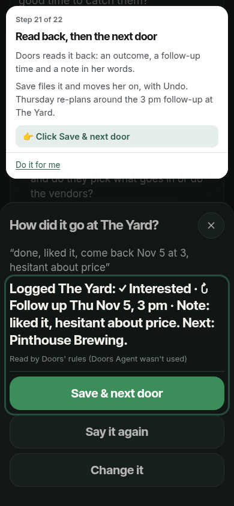 | 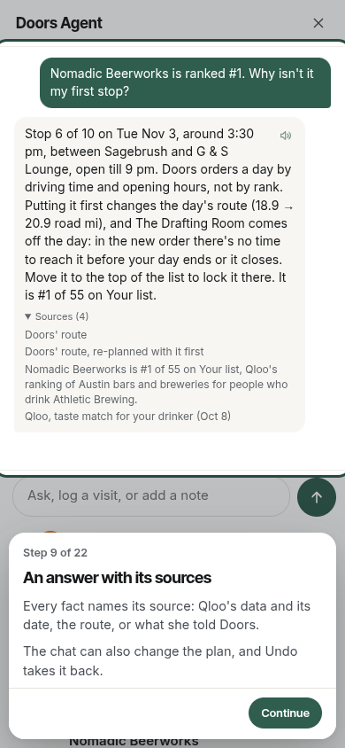 |
| 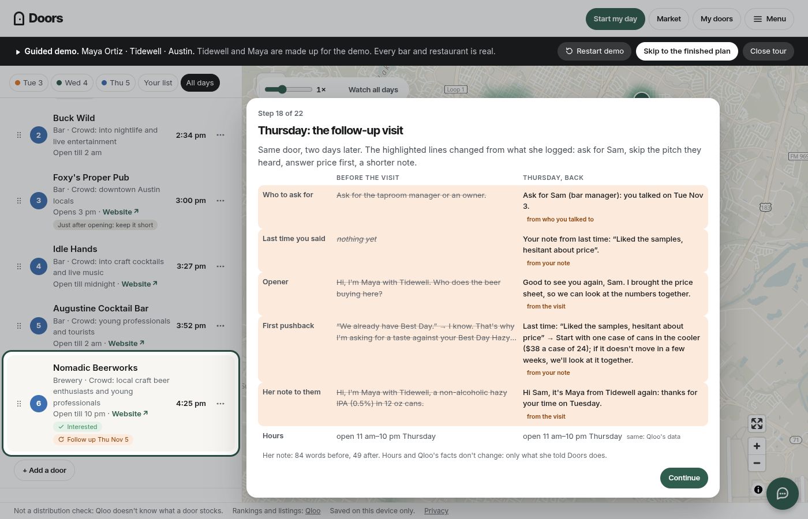 | 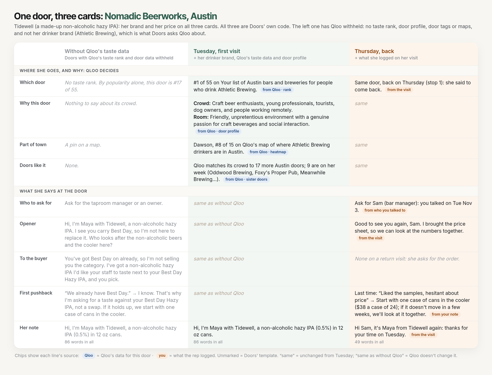 |
| 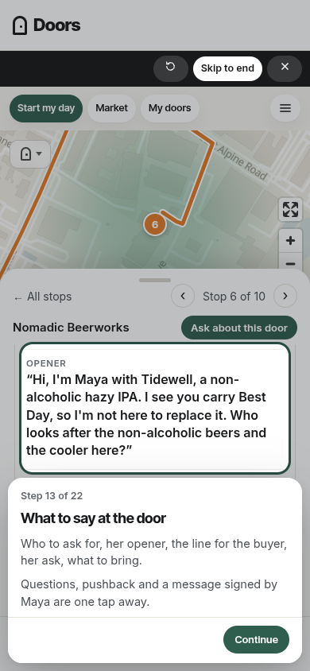 | 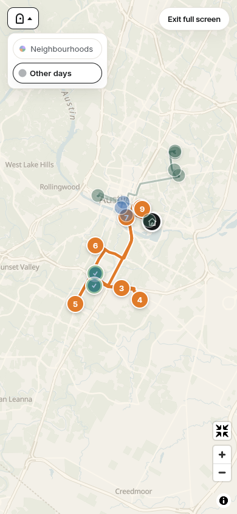 |


Every web picture comes from the guided tour, its finished plan or the landing's example day (`node scripts/doc-shots.mjs <base>`
re-shoots them all from the current tree, the link preview `public/og.png` and the Devpost lead image too), shot on a
dev server with no model connected, so Doors' rules answer the chat and read the spoken note in them.
The iPhone picture is one live run on a simulator, with real Qloo calls. The demo, ledger, agent and proof numbers quoted here and in `SUBMISSION.md` are checked by `node scripts/doc-numbers.mjs --check`; the planner numbers come from `node scripts/sweep-routing.mjs`.

## Architecture

```
browser (vanilla JS ES modules, no build step)
 ├─ static data: public/data/** ── ranked rooms per drinker × city (Qloo, precomputed), talk lines, facts, the demo bake
 ├─ planner + talking points run in the page: public/lib/schedule.js, travel.js, talk.js, stopmodel.js …
 ├─ map: MapLibre GL ── OpenFreeMap Positron (recoloured) → fallback /tiles/<city>.pmtiles (Protomaps) → OSM raster
 └─ /api/* ──▶ Cloudflare Worker (src/worker.js)
                ├─ /api/route ─────────────────▶ hackathon.api.qloo.com   (the live agent: any brand × any city, ~35 calls,
                │                                                            streamed as steps, kept in KV)
                ├─ /api/search ────────────────▶ hackathon.api.qloo.com   (brand search, Add a door)
                ├─ /api/place ─────────────────▶ hackathon.api.qloo.com   (one door's music + sister doors, on "Get it
                │                                                            from Qloo"; ≤3 calls, kept a day in KV)
                ├─ /api/talk ──────────────────▶ api.anthropic.com        (one door's talking points written by Claude Sonnet
                │                                                            from Qloo's facts; checked, kept 60 days in KV)
                ├─ /api/runs                       (the runs already made, offered when live runs rest)
                ├─ /api/matrix|directions|geocode ─▶ OpenRouteService     (live with ORS_API_KEY; estimate otherwise)
                ├─ /tiles/* byte ranges for the pmtiles fallback (src/tiles.js)
                └─ /api/health
```

- **Static data served as Worker assets.** `public/data/routes/<drinker>-<city>.json` (8 brands + one door preset ×
  4 cities: ranked doors with each door's record: hours, phone, website, photo, price, rating, Qloo's crowd and
  ambience text), `cities/<city>.json` (sister doors; the model-drafted Why this door lines under `pitches` and opener
  lines under `talk`, unused since 2026-10-24), `strip/<city>.json`
  (each brand's top 50, for the comparison in Market), `facts.json` (the only category facts, each with its
  source URL), `demo/demo.json` (the demo's baked roads and plan states), `index.json`.
- **The planner runs in the browser** (`public/lib/schedule.js`, pure, deterministic). Inputs: the ranked pool after
  the Door types, statuses, the windows, the time at each door, a travel function (road matrix if one answered, else
  the labelled estimate), pins (contacts and follow-ups), locks, the doors-a-day cap and the current day. **Fill by
  rank, then route**: each calendar week, in date order, takes the best-ranked free doors its
  days can hold (half again as many, since some sit far from every day's area); then its days are planned on those as
  below, one map area a day. A door below every week's set still goes on where it is on the way, in time a day has
  left. Within a week it solves a
  team orienteering problem with time windows, **driving first** (a door 15 minutes from the start
  costs 30 minutes there and back): each day is a loop from its
  start and back, the drive home counted as driving but not inside the window. A door is worth 15 minutes of that loop
  (`DOOR_MIN`) plus its rank's worth: `RANK_V` 45 × a top-heavy curve of its place in
  the drinker's raw Qloo list (#1 = 60 minutes in all, #10 = 43, #50 = 26), so a top door is worth a real detour
  (`?routing=v4` keeps V4's linear 10-minute rank range). Insertion, then iterated local search (Vansteenwegen et al. 2009), a swap pass, a drive pass
  and moves between days (a door goes to the day whose loop passes nearest). It allows up to 20 minutes of waiting for
  a door to open, ends each day at least 5 minutes before its window closes, leaves off no door that adds ≤ 15 minutes
  to a day under its cap, and gives every ranked door it leaves off a true reason ("opens 5 pm, after your window",
  "adds 22 min of driving to Wednesday"). With "Most doors a day", pins count toward the cap and are never dropped
  for it. A re-plan keeps today's order (a visit out of order re-routes the rest of today) and gives later days their
  previous doors back first. Over 161 test plans (`scripts/sweep-routing.mjs`): 7.4 doors a day, mean rank #27,
  41 minutes of loop driving a day (34 without the drive home), the #1 door kept in 81% of plans; planned the old way,
  before fill by rank (`?fill=area`): 7.8 doors, mean rank #36, 30 and 25 minutes, #1 kept in 78%. A plan takes a
  median of about 15 ms.
- **The Worker** (`src/worker.js`; wrangler's `main` is `src/entry.js`, which exports only the handler and the
  `SpendBook` Durable Object) holds every key. `run_worker_first = ["/api/*", "/tiles/*", "/manifest.webmanifest"]`; everything else is
  a static asset.
- **Local state**: one profile and plan per brand-city in `localStorage`, versioned, wrapped in try/catch; with storage
  blocked the app still works for the tab. "Saved on this device only."
- **The plan comes with you (Add to Home Screen).** iOS gives a home-screen app its own storage, so while a plan is open
  the page's manifest is `/manifest.webmanifest?c=<code>` (the Worker; no KV, no Qloo): `start_url` carries that plan
  (profile, statuses, outcomes, rules, the saved days; never the venues, which reload) as deflated base64url, about
  1.5–2.7 KB (`public/lib/carry.js`); the installed app's first start writes it into its own storage and opens it in
  drive mode. iOS reads the manifest link only as the page loads, so `app.html` writes it from `?c=` at parse time,
  drive mode keeps `?c=` current in the address, and the Menu's "Add to Home Screen" sheet (iPhone/iPad in a browser
  tab) has "Prepare", which reloads with `?c=` before Share → Add to Home Screen ("Ready" after).
- **The chat agent (Doors Agent, drive mode's Log visit).** `POST /api/agent` (one chat turn) and `/api/agent/log-visit`
  (`src/agent.js`; request and reply shapes in `docs/CONTRACTS-R9.md`). The client sends the conversation and what the agent may read
  (the plan's doors and their Qloo fields, the day, the rep's profile); the Worker keeps neither. The model chooses
  among the 13 tools declared in `public/lib/agent-tools.js` (explain_door, compare_doors, ask_city, replan,
  edit_talking_points, log_visit, save_note, brief_door, prep_day, draft_follow_up, what_to_bring, next_trip,
  remember); code validates every call against that context and returns facts (each with its source) and actions the
  page applies through `ui/state.js`, one Undo per batch. Model chain: Anthropic `claude-sonnet-5-5` (`AGENT_MODEL`; Sonnet by default since round 3, 2026-10-25, with every door's Qloo facts and the enrich record in its context and looser rules: `docs/AGENT2-EVAL.md`; the "Why aren't these on my plan?" ask (WHY-VIZ-SPEC §4.5): the thread panel sends `doors:ask {id, whynot: threadAsk(…), send: true}` (`lib/whyviz/thread.js`), the Worker rebuilds each door's fix from the table (`lib/agent-context.js whyNotFixOf`), the model answers per door with that fix word for word (`whyNotNet` falls back to the rules' text, `threadAnswer`'s, on any fix outside the table), and the reply's `whynot` carries each fix's action and the pick for the panel's buttons;
  an ask about a door's menu, events or news goes first to `claude-sonnet-5-5`, `AGENT_WEB_MODEL`, 10 such turns per
  visitor a day), then Workers AI `llama-3.3-70b` → `llama-3.1-8b`, then Gemini free tier (`3.5-flash` →
  `3-flash-preview` → `3.1-flash-lite`), then the rules (`public/lib/agent-rules.js`, also used in the page when the
  Worker can't be reached). Claude stops for the day for the whole site past `AGENT_USD_DAILY` ($30 a UTC day since round 3, priced from usage; one counter in
  the `SPEND_BOOK` Durable Object, `src/spend.js`).
  Before the prompt, tool results and the Day done polish reach a model, the rep's and saved contacts' names (and their
  first and last names) and names beside a role or a verb ("talked to Sam", "the manager is Priya") become "the
  contact"; phone numbers and emails become "a phone number" / "an email address"; a clause that describes a person
  (age, origin, religion, health, family and the like) is left out (`redact`, `namesIn`, `forModel`, `personalOut` in
  `public/lib/slots.js`). These are pattern checks, so a detail they don't recognise still goes through. Caps: 20 turns per visitor in 10 minutes and 60 a day (counted by each server
  instance), 10 a minute at Cloudflare's edge, a daily model-call ceiling; over a cap the rules answer and
  the panel says no model was used, never an error. The agent makes no Qloo call. Drive mode's visit parser
  (`public/lib/visit-parse.js`) is the rules path and the judge of the model's dates.
- **The agent's specialist brief and web search (Doors Agent, `src/brief.js`).** When a plan is built, the page and the
  app send `POST /api/brief {what, city}` (`public/lib/brief-client.js`, once per product line and city). The Worker
  maps the product line to a coarse category (non-alcoholic beer, craft beer, seltzer/RTD, cider, wine, spirits, soft
  drinks) and, unless KV already holds it, asks Anthropic (`claude-haiku-5-5`, no thinking, `BRIEF_MODEL` to change)
  with its `web_search` tool (social and people-search sites blocked) for a sourced brief on that category in that city,
  in two parts asked at once (2 searches each, 24 s cap each): the trade and the state's trade-practice rules; the
  scene, how people talk, what lands. Only the category and the city are sent. It is built once (~10–11¢, 7–8 s,
  measured 10-23, inside the ~30 s Cloudflare gives a request's work after the page goes away), kept 60 days in KV as
  `brief:v1:<category>:<city>` and shared; at most 30 builds a day and 4 per visitor. `GET /api/brief?what=&city=`
  reads it. Each agent turn reads it from KV (`briefForTurn` → `context.specialistBrief`, never from the client); until
  it is ready the agent says the brief is still loading. In a turn the agent may search public pages about a door
  (menus, events, happy hours) with the same tool, up to 2 searches a request and 15 a visitor a day; every web fact comes
  back with its link (`webFacts`, source kind `web`), shown under the reply.
- **Talking points written per door (group 3, `src/talk.js`, `public/lib/talk-gen.js`).** When a door's card opens and
  no set is held for it, the page sends `POST /api/talk {tf}`: a numbered list of facts (`talkFacts`): Qloo's facts
  about the door (Qloo's own summary of it, its description, hours, crowd times, feel, drinks and menu tags, interests,
  price level and rating; its rank and Qloo's match for the rep's drinkers, the crowd's music and sister doors marked
  "prep only"), the door's own website when the enrichment record has it (`lib/enrich.js`; the one kind of fact a line
  may state about the door's stock, cited), the product line, who the rep says drinks it, and the ask. The Worker asks
  Anthropic (`claude-sonnet-5-5`, high effort, structured output, no tools; `TALK_MODEL` and `TALK_EFFORT` to change) for one
  sharp insight about this door (the angle), the first line to the buyer, the questions, the points and the likely
  pushback, each line citing the facts it uses (round 3, Jard 10-25: fewer, sharper lines; nothing that would read the
  same at the next bar). `validateTalkSet` keeps the few hard rules: no number, name, event or room feature the facts
  don't hold; nothing said about what the door has unless its own site says so; no "Qloo", artist or sister door said
  out loud; no claim about other bars; never a statement that tells the buyer what their own room is like; the ask's own
  words when a reply offers a start; plain trade words. A failing line is dropped and the model gets one second try
  naming what failed; a set without its angle, a question and a point is not used (the template shows). Kept 60 days
  in KV by the facts' hash, so a door with the same product and ask is written once; the page keeps its sets on the
  device and checks them again before showing them. Who to ask for, the arrival time, what to bring, the opener and the
  ask stay Doors' own. Since round 3 the opener (hello, who the rep is, who buys here in this door's terms) and the
  drafted message to the door (subject, body and text, asking for a time and a taste) are the model's too, written in
  the same set with `{rep}` and `{when}` placeholders that the device fills from the profile and the plan, so the rep's
  name never leaves Doors and the visit time stays computed; a return visit keeps the template built from what the rep
  logged. Nothing on the door says a model wrote the lines (round 3: "our users don't need to know how the
  sausage is made"); `privacy.html` does. Caps: the site's daily Claude $ (shared with the Agent), 120 sets per visitor
  a day and 40 per 10 minutes. The demo and the examples' plan doors and top 25 are baked (`scripts/talk-bake.mjs` →
  `public/data/talk/<city>.json`, logged in `data/talk-bake.jsonl`; each set is stamped with the key of the facts it
  saw, the enrichment record included, so a re-run only writes the doors whose facts changed or whose sets no longer
  pass, `--redo` writes them all; a billing or rate-limit error stops the run), so they show with no live call. Measured: about $0.02–0.05 a door (Claude Sonnet 5.5, high effort; Jard picked Sonnet over Opus 5.5 for shorter lines, with the prompt asking for the point and no more).
- **Drive mode's voice.** `POST /api/voice/listen` (a 16 kHz mono WAV, ≤ 800 KB, → `{text}`
  by Workers AI `@cf/openai/whisper-large-v3-turbo`) and `POST /api/voice/say` (`{text}` ≤ 600 characters → MP3 by
  `@cf/deepgram/aura-2-en`, or `@cf/myshell-ai/melotts` when the day's neurons are short; the `x-doors-voice` header says which) (`src/voice.js`).
  Out: the page (`public/ui/voice.js`) reads everything in the Worker's Aura-2 voice first, the one Doors voice on the web and the
  phone, through one `<audio>` element that drive mode's first tap unlocks (so iPhone plays later replies with no tap, and
  through the ringer switch); the browser's own speech only when the Worker can't. In: the browser's recognizer first,
  the Worker when it fails: a recognizer error `network` (Brave), no recognizer (Firefox), a recognizer that hears
  nothing while the page's own recording heard speech (Chromium on Linux). What failed is remembered for the page's life;
  when the Worker can't either, the sheet says so and the dead button goes. The hands-free Agent (`public/ui/handsfree.js`,
  a bar under the drive screen) listens from the moment drive mode opens, through quiet gaps and after each answer (the
  page's own recording, nothing sent until there's speech; Mute stops it); when the words are in it says a short canned
  line at once (`public/lib/ack.js`, baked Aura-2 clips in `public/audio/ack/`, `scripts/bake-acks.mjs`) while the model works. Free neurons from the agent's share of the day (a 6 s visit ≈ 5, a read-aloud of 150 characters ≈ 410); 30
  calls per visitor in 10 minutes, 200 a day, `VOICE_LIMITER` at the edge; same-origin only; nothing stored or logged.
- **The planner agent, plainly.** A scripted planner-executor, no model choosing. For a brand and city Doors holds,
  the page needs no Qloo call. For any other brand or city (**the live agentic path**), the Worker's agent
  (`runRoute`, `POST /api/route`) resolves the brand, asks Qloo for the city's bars and restaurants ranked for its
  drinkers (3 pages of 50), re-ranks them by age, checks the most popular doors, finds sister doors for its top 12 doors and
  the sound of up to 12, then drafts the notes: about 35 Qloo calls, streamed to the page as steps ("Doors is asking
  Qloo…"), and kept server-side in KV by drinker and city, so a repeat costs none. The page stores the files it
  returns where the held ones go, so the plan, Your list, Market, the stops and saved plans work the same.
  Then it ranks and filters, routes each day, drafts the note and talking points per door, and re-plans from every
  status the rep records (visited, not a fit, already know them, follow-up). Model text is labelled where it appears
  (see Gemini below).

## Every external call

### Qloo (`https://hackathon.api.qloo.com`, header `X-Api-Key`, server-side only)

At runtime the page calls Qloo only on an explicit click:

| Purpose | Request | Doors route |
|---|---|---|
| Find a brand not in Doors' drink list (on "Search Qloo for …"); the name typed first, Qloo's drink tags break ties, clearly non-drink ones dropped. The list itself (`public/data/drinks.json`, ~1,270 drink brands from Qloo's genre and industry tags, `scripts/make-drinks.mjs`) is searched in the page as you type, no call | `GET /search?query=<q>&types=urn:entity:brand&take=10` (1 call) | `/api/search?type=brand&q=` |
| Add a door by name (plan view) | `GET /search?query=<name> <City>&types=urn:entity:place&take=10`; places within 40 km of the city centre are kept; the answer carries the place's record (location, hours, address), so 1 call per search | `/api/search?type=place&city=<key>&q=` (a held city) or `&cityName=<name>&lat=&lon=` (any other) |
| Find a door that already pours you, in any city ("Doors that already pour you"), on "Search Qloo for …"; bars and restaurants only (an airport or hotel the search returns is dropped), shown as "name · neighbourhood, city" from Qloo's geocode. Doors' own preset door matches as you type, no call | `GET /search?query=<q>&types=urn:entity:place&take=10` (1 call) | `/api/search?type=room&q=` |
| A door's music and sister doors, when Qloo hasn't been asked about it yet ("Get its music and sister doors from Qloo" on Why this door and Everything Qloo knows); the answer is kept on the device and a day in KV, and the music only shows when it passes the same sound check as a run | `GET /v2/insights` with the door as `signal.interests.entities`: `filter.type=urn:entity:place` in the city (sister doors) and `urn:entity:artist` (its crowd's music, not asked under 0.2 popularity), plus the city's artists once a day for the check (≤3 calls) | `POST /api/place {id, city, want}` from Doors' own page, inside the build's monthly budget like a live run |
| **A live plan's door, enriched** (round 3, `public/lib/enrich.js`): the brands its crowd over-indexes on, its drink brands by kind, its age and gender skew and its taste tags, with the door as the signal; plus its own public website read for what it pours, brews and does (robots.txt honoured, no third-party platforms, one model call, every fact with a verbatim quote). Kept a day in KV; a held city's doors read the baked file instead (`public/data/enrich/<city>.json`, `scripts/enrich-bake.mjs`) | `GET /v2/insights` with the door as `signal.interests.entities`: `filter.type=urn:entity:brand` (`take=30`), the same with `filter.tags=urn:tag:genre:brand:wine_and_spirits`, `filter.type=urn:demographics`, and `filter.type=urn:tag` with `filter.tag.types=` music genres, specialty dishes, keywords, audiences, hobbies, emotional tone (4 calls). A door Qloo refuses as a signal (400 "invalid", about one in four) gets one call for its part of town instead: `signal.location=POINT(lon lat)` · `signal.location.radius=1200` · the drink-brand filter | `POST /api/enrich {id, city, name, lat, lon, website, menu, want}` from Doors' own page, inside the build's monthly budget |
| **A live run** (Build, for a brand or city Doors holds no files for) | the agent's calls, below: about 35 per drinker brand, none when the run is already kept | `POST /api/route` with a JSON body from Doors' own page (NDJSON: one line per step, then the route and city files) |

The live agent (`src/worker.js` `runRoute`) makes, per drinker brand: the brand's search when it has no id yet; the
ranked doors, pages 1–3 (it stops at a short page); three age re-ranks (`ageBuckets`); the most popular doors (page 1
without the popularity cap); sister doors for its top 12 open doors; the door sound of up to 12 of its route doors
(none under 0.2 popularity: Qloo rejects those with a 400, which still counts); the city's artists and the brand's
artists. **Doors that already pour you** (1–3 places from any city, with any brands picked) make one run, not one per
drinker: every door and brand goes into the same `POST /v2/insights` as `signal.interests.entities` with weight 1
(Qloo blends places and brands in one call, with per-entity explainability; probed 2026-10-22), the rep's own doors
are dropped from the doors and from every list, and there are no brand artists; the age re-ranks, the uncapped page, the
hooks and the heat map come from the same weighted POST body (qloofull, 2026-10-27); about 25 calls. Its words are
"regulars like those at <room>" (with brands: "LaCroix drinkers and regulars like those at …"), and the drafted message
may name the doors (the rep's data, not Qloo's). It is not listed among the saved runs. If Qloo reads the city as a state ("New York, NY" → the state of New York), the agent stops after the first
call and asks for the city itself ("New York City"). Only page 1 of the ranked doors is required: any other call
Qloo refuses (a 429 after two jittered retries, at most 8 retries a run to stay inside the free plan's 50
subrequests; a cap; a dropped connection) leaves its part out, the step lines say what Qloo didn't answer, and the route
carries `gaps`, short labels ("city sound", "brand artists") the plan view shows in one line, "Qloo didn't answer for:
city sound, brand artists. Run it again tomorrow to fill them in." (with no city or brand artists at all, every door's
sound is held back as "unchecked"). The device keeps a run with gaps a day too, then asks again. A 429 also holds
back the isolate's next calls. Each run's route and city files are kept in KV for 30 days (1 day for a run with gaps) under
what was asked (kind, drinker id, the NA flag, the city as typed, Unicode-aware) and under Qloo's own name for the
city.

**Popular runs cached from real Qloo calls.** `scripts/prewarm.mjs` runs the same agent, locally with the real key,
for a fixed demo set: 15 popular US drink brands (Modelo, Michelob Ultra, Guinness, Stella Artois, Coors Light,
Heineken, High Noon, Truly, Tito's, Jameson, Aperol, Topo Chico, Athletic Brewing, Liquid Death, White Claw) across
14 big US cities, 114 pairs, 2,070 calls, each logged in the ledger. `scripts/publish.sh` loads the results into
KV, so the site starts with them saved: a judge who picks one of those brands and cities gets the plan at once, at no
call.
Those saved runs carry what a held city's files carry (qloofull, 2026-10-27, so no feature shows empty for want of a
call): every age re-rank (`scripts/qloofull-fill.mjs --prewarm-ages`), Qloo's tag families on every ranked door
(`scripts/deep-prewarm.mjs --tags`, `--apply`), sister doors and the door sound for the top 40 of every run
(`scripts/qloofull-place.mjs`, checked as a run checks them) and each top-40 door's enrichment record
(`scripts/enrich-bake.mjs --prewarm`, to `public/data/enrich/<city>.json`, read by the page for that run). The Parson's
preset carries its age re-ranks, uncapped page, hooks and (Chicago) heat map too (`--rooms`). Jard's own demo runs from
the dev server's KV go through the same fills (`scripts/qloofull-dev.mjs` → `data/prewarm-dev/`).

For the brands and cities Doors holds, everything else on screen comes from **the precompute: a cache of real Qloo
calls** (private server-side caching, allowed by Qloo's rule in the hackathon's Discord on Oct 6), run once in October 2026 with every
raw response cached under `data/raw/` (git-ignored). It backs the Examples and the guided demo. `PLACE_TAGS` =
`urn:tag:genre:place:restaurant, urn:tag:category:place:bar, urn:tag:genre:place:restaurant:bar`.

| Purpose | Request (`src/plan.js`) |
|---|---|
| Ranked doors for a brand's drinker | `GET /v2/insights` `filter.type=urn:entity:place` · `signal.interests.entities=<brand id>` · `filter.location.query=<city>` · `filter.tags=<PLACE_TAGS>` · `operator.filter.tags=union` · `filter.popularity.max=0.9` · `feature.explainability=true` · `take=50` · `page=1..3` |
| The most popular doors (popularity above 0.9) | the same call, page 1, without `filter.popularity.max` |
| A door as the drinker (Parson's Chicken & Fish preset) | the same call with the venue id as `signal.interests.entities` and `filter.exclude.entities=<venue>` |
| Sister doors (shown on a stop) | `GET /v2/insights` `filter.type=urn:entity:place` · `signal.interests.entities=<place>` · `filter.location.query=<city>` · `filter.exclude.entities=<place>` · `filter.tags=<PLACE_TAGS>` · `operator.filter.tags=union` · `take=20` |
| City and brand artists (to keep artist names out of every drafted line) | `GET /v2/insights` `filter.type=urn:entity:artist` with `signal.location.query=<city>` (`take=50`) or `signal.interests.entities=<brand>` (`take=30`) |
| Per-door market research (round 3, lane deep, `public/lib/deep.js`, `scripts/deep-bake.mjs`): for each door, the gap between what its own site lists and what its crowd buys in the rep's category, the same-crowd and nearby doors whose sites carry what it doesn't, the owner's week (hours, Qloo's day parts, happy hour, events → the likely quiet window), the room's occasion; ranked, every line with its fields and its "so what"; talk-gen's D facts and the Agent's insight lines | none: computed from the enrich records, the city file's sisters and the route files' coordinates (`public/data/deep/<city>.json` is only the baked neighbour map) |
| Per-door enrichment (round 3, `scripts/enrich-bake.mjs`, `src/enrich.js`): every route door in the four held cities | the four door-as-signal calls of `/api/enrich` above (one area call when Qloo refuses the door as a signal); what is distinctive is decided in `public/lib/enrich.js vsCity` against the city's other enriched doors (≥ 1.5× the city for a drink kind, ≥ 3× for a single brand or tag), with no further calls |
| Resolving the brands and the preset door | `GET /search?query=&types=urn:entity:brand` (or `urn:entity:place`) `&take=5` |

Fields read from each place: `name`, `location`, `address`, `hours`, `phone`, `website`, `images`, `price_level`,
`business_rating`, `neighborhood`, `tags` (genre), `customer_demographics_description` (the crowd text Doors calls
"Qloo's profile of this door"), `ambience_description`, `good_for`, `live_music`, `specialty_dishes`, `query.affinity`.
The first precompute also fetched age re-ranks, three-things-they-love presets and door sounds (artists Qloo associates with a
door). Drafted text never names an artist (the city and door sound data keeps them out). Market
(`ui/why.js`, `lib/insights.js`) charts the age re-ranks and, for doors whose sound passed the guard, the artists and
genres Qloo associates with each door's audience, labelled as such; it also reads `popularity` (each place's record)
and counts phrases in the crowd text. Why this door (`ui/why.js`, `lib/place.js`) opens on the place, assembled from
Qloo's fields for it, never written freely: its crowd description, time-of-day and visit tags, ambience tags and live
music, beverage tags, interest tags, its best age band, its crowd's music (when the check passed) and its first three
sister doors; then one line on why it is or isn't on the plan, with Qloo's steps behind "How this door was chosen". The
held cities carry sister doors and door sounds for the top 50 of every held list (`scripts/place-fill.mjs`). The door deep-dive (`ui/room.js`, from a stop's "Why this door") shows one
door's age re-ranks, every held brand's rank for it, its sister doors with their scores, and its sound only when it
passed the guard. List rows are `[id, affinity, audience_growth, explainability]`: `query.affinity`,
`query.measurements.audience_growth` (meaning undocumented; not shown) and `query.explainability`, kept only for
multi-entity signals (the proxy sets), so null on brand and venue lists.

**Budget and guards.** Two limits apply. Qloo's key allows 50,000 calls a rolling month (its headers on Oct 21 put
the reset around Nov 20) and 10 a second. The build's own ceiling is **34,000 Qloo calls a calendar month**
(`BUILD_BUDGET` in the Worker, `LEDGER_BUDGET` in `src/ledger.js`), keeping 16,000 of Qloo's 50,000 unspent;
**27,795 used in October 2026** so far (precompute 1,279 including 75 retries and 107 answered 400; development,
live-run tests and the pre-publish audit 733; the pre-warm 2,070 for 114 popular brand × city runs including its
proof; probes of Qloo's catalog, search and tags 181; the deep-data passes (door tags, heatmap, taste hooks) 219;
music and sister doors for the top 50 of every held list 956; the 21–24 and 55-and-over lists for every held brand and
city 52; the per-door enrichment of every route door in the four cities, round 3, 7,994; the saved runs' fill of
2026-10-27 (age bands, tag families, sister doors, sounds and enrichment records for the top 40 of every saved run) and
Jard's demo runs 14,303; post-test 3). Every request that reaches Qloo is a line in
`data/ledger.jsonl` (`node scripts/ledger.mjs` prints the total). In production one KV value a month, `count:<YYYY-MM>`
(`DOORS_KV`, its calls seeded from the ledger by `scripts/publish.sh`), holds the month's calls and today's new runs,
KV writes and runs per visitor; it is read before every new run and written once when the run ends. The guards
(`src/guard.js`, `src/kvbook.js`, `src/worker.js`) are there so that one visitor can't push the site into resting
for everyone else, and so the site fits Cloudflare's free KV plan (1,000 writes and 100,000 reads a day):
- **A run already made is free and never limited:** the Worker answers it from KV with no Qloo call and no write.
- **The site's own daily ceiling on new runs:** what is left of the month's ceiling, spread over the days left to the
  end of judging (Nov 16), counting 41 calls a run (a run's most); at least one a day.
- **Each visitor** (an IPv4 address, or an IPv6 /64; the KV counter keeps only a salted one-way hash of it per day, `src/guard.js` visitorKey, salt `IP_SALT`, else derived from the Qloo key secret): 5 new live runs a day, 12 per 10 minutes, and 3 a minute
  through Cloudflare's rate-limiting binding. At most 2 new runs at once per Worker isolate. A run that fails before
  it spends (no such brand, no doors, a city read as a state) doesn't count.
- **Counting:** a new run writes KV at most twice: its own value (the route and city files, with its saved-runs entry
  as metadata, so the list is a KV list(), not a write) and the counter once when it ends. A saved run and a search
  write nothing; ORS caches road matrices and directions (one write each, only while today's writes are under 950),
  never a geocode. A run's reserve is held in memory until it settles. If the counter can't be read, the run rests:
  it never goes on uncounted. New runs also rest once today's KV writes reach 800 of the 1,000.
- **Resting:** with less than two runs' worth left under the ceiling, or fewer than `QLOO_RESERVE` (2,000) calls left
  on the key, a new run does not call Qloo. Neither that nor any visitor limit is ever an error page: the page says
  "New plans are off for today: the daily limit is used. Try one of the examples, or a brand and city someone has
  already run." and offers
  the Examples and the runs already made (`/api/runs`: Qloo's names for the cities, never a visitor's text), each one
  click away.
- **From Doors' own page only:** `/api/route` takes `POST` with `application/json` and the site's own `Origin`;
  `/api/search` refuses another site's `Origin`. A third-party page can't make its visitors start runs or searches.
- **Searches:** 40 a day per visitor and 40 per 10 minutes (each Worker isolate's memory), 10 a minute through a
  second rate-limiting binding, each counted in the budget, no KV write; a one-day browser cache and a per-isolate
  memory cache. Inputs are validated before any request.

v1's lazy extras (`/api/sisters`, `/api/door`) are off: they answer 410 unless the Worker has `V1_ROUTES=on`, so a
visitor can't spend the budget through them. `/api/route` is v2's live agent.

### Gemini

One kind of model text ships, drafted offline with `gemini-3.1-flash-lite` from Qloo's text about the door only and
labelled on every stop where it appears. A live run adds a second (below). Everything else on a stop (the arrival, rank
line, opener, the line for the buyer, the drafted message, questions, points, facts, pushback, the ask) is a template
over Qloo's data and the rep's profile.

- **Why this door** (the Crowd and Room lines): `scripts/pitches.mjs` drafted them for **2,217 doors** (the top 60 of
  every precomputed list and every door on a precomputed route) from the door's crowd, ambience, good-for, live-music and dish fields, stored under
  `pitches` in `cities/<city>.json` (cache `data/pitches.json`). Each line is checked (length, banned words, its source
  field present) and a failing line is replaced by the template line. Labelled "Crowd and room lines written by a model
  from Qloo's profile of this door"; doors without a draft show the template line and say "Crowd and room lines from
  Qloo's profile of this door".
- **Opener lines, no longer shown (since 2026-10-24):** `scripts/talk.mjs` drafted a first sentence for the opener
("Looks like your regulars are …") for 650 doors from Qloo's crowd text (cached in `data/talk.json`, stored under `talk`
in the city files). Doors no longer shows them: nobody tells a bar who its regulars are (owner's review, 10-24;
`../OPENERS-RESEARCH.md`). The opener is now a template (the rep's intro, who buys and when to catch them), and the
drafted message never quotes the crowd text. Qloo's crowd text still decides the daytime and sports angles (the line
for the buyer and the rep's prep line built from them); the drinks, menu, interests and ambience tags decide the rest.

- **A live run's Why this door lines:** the agent asks `gemini-3.1-flash-lite` once (12-second limit) to draft them
  for its route doors (about 12) from each door's own Qloo descriptions, labelled model-drafted the same way; if it
  doesn't answer in time, or no key is set, those doors show the template line.

- **Doors Agent and drive mode's Log visit** call a model through the Worker on every turn (the chain above: Claude first,
  Gemini last); the panel says "Your messages go to Anthropic's Claude, or to Workers AI or Google Gemini when Claude can't answer, with names removed first; voice goes to Cloudflare." and names the model that answered (badge, and "This answer: …" in the footer). The guided tour makes no model call (its chat and spoken note go to the rules in the page).

### Road routing and geocoding: OpenRouteService

The Worker has three endpoints (`src/ors.js`): `POST /api/matrix` (→ ORS `/v2/matrix/driving-car`, durations and
distances), `POST /api/directions` (→ `/v2/directions/driving-car/geojson`) and `GET /api/geocode` (→ `/geocode/search`
focused on the city: a held city's centre, or for any other city its name, then its centre once found with
`kind=city`). With the `ORS_API_KEY` secret set (publish.sh stores it from a local key file),
plans for your own profile use real road minutes and miles, routes draw on real roads, and typed addresses
resolve; checked live on 2026-10-09 and recorded in `test/fixtures/ors/live-*.json`. Directions are requested with
`instructions: true`, because without instructions ORS returns no per-leg segments (the parser handles that shape
too). Without a key, or when a limit or error hits, every answer is the **estimate**: straight-line distance × 1.35 at 18 mph, labelled everywhere ("mi · est.", "estimated:
straight-line distance × 1.35 at 18 mph"), drawn as a dashed line, and the address field says "Address search is off
right now: pick a starting point below or drop a pin". With a key (`ORS_API_KEY`), the same endpoints answer real roads
and the labels say "road mi". The endpoints are the provider seam: the page only sees miles, minutes and
`source:"ors" | "estimate"`, so a Geoapify adapter can sit behind them later.

**The city and start fields.** The city field narrows as the rep types from a static list of the 1,923
US cities of 20,000+ people (`public/lib/us-cities.js`, matched by `public/lib/citylist.js`: prefix, accent- and
case-folded, "st" = "saint", "City, ST"; biggest first; the four held cities keep their keys). No Qloo call and
no network; any other pick is a live city with its centre from the list. Once a city is picked, "Where your day starts"
predicts as the rep types: `GET /api/geocode?kind=auto&q=&lat=&lon=` (→ ORS `/geocode/autocomplete`, focused on the
centre, boxed ~40 km, addresses, venues and streets), from 3 characters, 250 ms after the last key, stale requests
aborted. Predictions are cached in the isolate's memory only (0 KV reads or writes a keystroke) and capped: 800 a day
for the site, 80 a minute for the site, 200 a day and 60 per 10 minutes per visitor (ORS: 1,000/day, 100/min). Past a
cap or on an ORS error the field says "Address lookup isn't available right now: … Pick a starting point below or drop a pin on the map
instead.", and the pin
and starting points still work.

ORS Standard plan limits (read 2026-10-08 from account.heigit.org/info/plans): directions 2,000/day and 40/min, matrix
500/day and 40/min, geocode 1,000/day and 100/min; 50 waypoints per route, 3,500 cells per matrix. Doors' own daily
ceilings sit below: 1,600 / 400 / 800 (KV `ors:n:<kind>:<date>`), plus a per-IP limiter per 10 minutes (120
directions, 60 matrices, 60 geocodes). Every real answer is cached in KV for 30 days; estimates are never cached. A
limit, an error or `?ors=off` all answer the labelled estimate, never an error page.

### The demo's roads: OSRM (offline bake)

"Watch the tour" and the landing hero draw real road geometry and use real drive times without any routing key. They
were baked once by `node scripts/bake-demo.mjs` from the public OSRM demo server (`router.project-osrm.org`): 1 `table`
request over the start and every door in the demo's pool, and 1 batched `route` request for the days shown. At most 10
requests per run, one per second, with a descriptive User-Agent; 11 requests in all to date. Answers are cached in
`data/demo-osrm-cache.json`. Shown as "Routes: OSRM, © OpenStreetMap contributors" on the map, in the plan footer and
on the hero. While the demo is on screen the page refuses every same-origin `/api/` request, so it makes zero Qloo,
ORS, Claude, Workers AI or Gemini calls.

### Map tiles

- **OpenFreeMap** Positron style (`tiles.openfreemap.org`), recoloured to Doors: "OpenFreeMap © OpenMapTiles Data from
  OpenStreetMap".
- **Fallback:** if the style or its tiles fail (or no `idle` within 6 s), self-hosted **Protomaps** files
  (`public/tiles/<city>.pmtiles`, cut from `build.protomaps.com/20261008.pmtiles` at maxzoom 14; 5–22 MiB each, under
  the 25 MiB asset limit) drawn with `@protomaps/basemaps`: "Protomaps © OpenStreetMap". The Worker answers their
  byte-range requests itself (`src/tiles.js`), because Cloudflare does not document Range support for Workers static
  assets. Last resort: **OpenStreetMap** raster tiles, "© OpenStreetMap contributors". Force a step with
  `?map=protomaps` or `?map=raster`.
- Libraries served from our own origin (`public/vendor/`, pinned, licenses beside them): `maplibre-gl@5.24.0`,
  `pmtiles@4.5.0`, `@protomaps/basemaps@5.7.2`, and the Protomaps fallback's glyphs and sprites, so no CDN can blank
  the map, and the page fonts, Inter and Inter Tight (OFL). Still external: OpenFreeMap's style and tiles, OSM raster
  tiles (last fallback), and Qloo's venue photos.

## Run it

Needs Node 22+. No dependencies.

```sh
SAMPLE=1 NO_MODEL=1 node scripts/dev.mjs 8789   # http://localhost:8789, offline (no Qloo, model or ORS call)
node scripts/dev.mjs 8789                       # with QLOO_API_KEY, GEMINI_API_KEY, ORS_API_KEY in the env (or key files, see dev.mjs)
npm test                                        # the offline test suite; global fetch is a tripwire
node scripts/ledger.mjs                         # Qloo calls used this month
npx -y wrangler@4 deploy --dry-run --outdir .out/dryrun   # bundle check, no account needed
```

In this public copy the pages load offline, but the tour and Examples need the Qloo data, which this repo leaves out
(see "Data"): use the live demo for those.

Useful URL flags: `?ors=off` (force the estimate), `?map=protomaps|raster`, `?instant=1` (no animation),
`?speed=2`.

Proof scripts (headless Chromium over CDP, real time): `node scripts/demo-cdp.mjs http://127.0.0.1:8789 <out-dir>
[w] [h] [--reduced]` plays the demo, times every beat, logs every request and screenshots each beat.

## Data

This repo holds no Qloo response data: Qloo asked hackathon entrants not to store its responses in a public repo
(the hackathon's Discord, Oct 6, 2026). The live demo serves the precomputed data from the deployed Worker; this repo has the code that
makes it. Left out here: `public/data/**` except `facts.json` (hand-sourced), all of `data/` (entities, pitches, talk
lines, extra doors, the call ledger, the OSRM cache), the Qloo-derived test fixtures, and the real `src/sample-data.js`
(an empty stand-in ships instead). `npm test` runs the test files that need no data and names the ones it skips.

Not from Qloo, and in this repo: the city list `public/lib/us-cities.js`, US Census Bureau data (public domain): the
Vintage 2024 city population estimates (`sub-est2024.csv`, census.gov popest "cities and towns" totals) joined to the
2024 Gazetteer places file (`2024_Gaz_place_national.txt`) for each place's internal point. Regenerate with
`node scripts/make-cities.mjs <dir with both files> [minPop=20000]`.

To regenerate everything with your own key (`QLOO_API_KEY` in the env; Gemini
optional): run the precompute phases in order, `node scripts/precompute.mjs resolve`, then `pages`, `refs`, `venues`,
`nbhd`, `fill`, `day1` and `build` (every response is cached under `data/raw/`, every call logged in
`data/ledger.jsonl`; a full run is most of a month's hackathon budget, so try `--only=<brand>-<city>` and `--dry`
first). Then `node scripts/talk.mjs` and `node scripts/pitches.mjs` (Gemini; without a key the template lines are
used), `node scripts/bake-demo.mjs` (the demo's roads, OSRM), `node scripts/make-sample.mjs` (the offline sample for
`SAMPLE=1`) and `node scripts/make-fixtures.mjs` (planner test fixtures). After that `npm test` runs the full suite.

## Data scripts, and when to re-run them

| Script | Calls | Re-run when |
|---|---|---|
| `node scripts/precompute.mjs <phase>` (`resolve`, `pages`, `refs`, `venues`, `nbhd`, `day1`) | Qloo | Never without budget. With `data/raw/` present it is free; without it, it is most of a month's calls. |
| `node scripts/precompute.mjs build --force` | none | Refuses without `--force`: the shipped `public/data/**` was enriched after the build (door tag families by `scripts/deep-tags.mjs`, culture files, filled pitches), and a rebuild drops that. Only for a fresh tree you will re-enrich: then `node scripts/talk.mjs --write-only` (build drops the `talk` key), the deep scripts, and delete `public/data/coverage.json`. It no longer writes the v1 three-loves routes. |
| `node scripts/talk.mjs` | Gemini | To draft opener lines for doors that have none (resumable; cached in `data/talk.json`). The app no longer shows them (2026-10-24). |
| `node scripts/bake-demo.mjs` | OSRM, ≤ 10 | After any change to `schedule.js`, `pool.js`, `travel.js` or the demo persona. `test/demo.test.mjs` fails with "re-run node scripts/bake-demo.mjs" when the bake and the planner disagree. Commit `public/data/demo/demo.json` and `data/demo-osrm-cache.json`. |
| `node scripts/qloofull-fill.mjs --prewarm-ages\|--culture\|--rooms`, `node scripts/qloofull-place.mjs`, `node scripts/enrich-bake.mjs --prewarm --qloo` | Qloo | After a new pre-warm (`scripts/prewarm.mjs`) or new dev runs (`scripts/qloofull-dev.mjs`): the saved runs' age re-ranks, culture, sister doors, sounds and enrichment records (cache-first: a re-run asks only what is missing). |
| `node scripts/enrich-baseline.mjs` | none | After any enrich bake: regenerates `src/enrich-baseline.js`, the baseline a live door's record is compared with (`/api/enrich`). |
| `node scripts/sweep-planner.mjs` | none | After a planner change: the 128-plan sweep behind the planner's bars. |
| `node scripts/sweep-routing.mjs [planner.js]` | none | Doors per day, mean rank, idle and driving minutes, and doors a day could have taken as it stood, over 161 plans; pass an older `schedule.js` to compare. |

## Publish

`scripts/publish.sh` checks that no tracked file contains any key file's contents, runs the full tests, creates the
KV namespace and seeds the Qloo counter from the ledger, puts the Qloo key (and the Gemini, ORS and Geoapify keys when
their files exist) as Worker secrets, deploys from the private tree (so the Worker serves the full data), smoke-tests
`/api/health`, and writes the live URL into this README and SUBMISSION.md. It then builds the public copy with
`scripts/export-public.sh` (the committed tree minus the Qloo data under "Data", guarded and tested) and pushes only
that copy to the public GitHub repo; the private history is never pushed.

## Limits

- **Not a distribution check.** Qloo doesn't know what a door stocks. A door is a door whose regulars look like your
  drinker, not a door that sells you or a competitor. Talking points ask what they carry; they never claim it.
- **Estimate vs road.** With the ORS key (set at publish) the live app's miles and times are real roads ("road mi").
  When ORS is unavailable or over its free limits they are straight-line × 1.35 at 18 mph, labelled as estimates on
  every leg, day, footer and export. The demo and the hero use roads baked from OSRM.
- **Hours** are each venue's own Qloo listing, captured 2026-10-08 and shown with that date; unparseable hours say
  "hours unverified" and are allowed.
- **Doors' Claude calls are capped at $30 a day** for the whole site, one counter for every Claude call (Agent turns and
  their web searches, trade briefs, the Day done polish): past that, or when Claude fails, Workers AI, Gemini's free
  tier or the rules answer, and the reply says "Claude's daily budget for Doors is used up; it's back after midnight
  UTC."
  Cultural grounding is checked by code and screened by a different model (`scripts/proof.mjs`; its report quotes Qloo output, so it stays private); no person has rated it
  yet: no rep, no founder.
- **The iPhone app** (`app-mobile/`, React Native with Expo) has every screen of the web app, on the same Worker and
  planner code. The full app was tested on iOS simulators (a Release build, including a live run) and runs as a signed
  Release build on two real iPhones (every screen tapped on an iPhone XS; the owner's own use on an iPhone 17). It is not in the App Store, so the web app (and Add to
  Home Screen) is the judge-testable one.
- **Saved on this device only.** No accounts; clearing the browser clears the plan. Export the CSV to keep it.
- **A city Doors holds no files for is thinner.** The start is an address or a pin (no starting-point buttons); the
  Why this door lines are model or template lines for the agent's ~12 route doors and the template beyond them;
  sister doors and door sounds come with the run for its top 12 and up to 12 doors (any other door has "Get its music
  and sister doors from Qloo", ≤3 calls); and Market has no city base (the
  other held brands' lists in that city), so those comparisons drop out.
- **Qloo reads some city names as states** ("New York, NY" → the state of New York); Doors stops that run after one
  call and asks for the city itself ("New York City").
- **Rank is a door's place on Your list.** "#k of N on Your list" is Qloo's order for the drinker and city after the
  Door types filter, the same number on every screen; with several drinker brands the lists are merged in turn (Doors'
  order, built from Qloo's ranks). Each week takes its best-ranked doors first;
  within the week the planner puts driving first, so a day may skip a better-ranked door far off its loop; Your list
  says why for each one. No trending or momentum claims anywhere.
- Qloo's city lists include nearby towns (Buda and Bee Cave for Austin); the drive there costs a day its doors, so the
  planner reaches them only when a day starts near them or has the hours to spare.
- Category facts are a fixed list (`public/data/facts.json`), each shown with its source link; alcohol brands get
  only the two general bartender facts.

## Built with AI

Built by one person with Claude Code agents (planning, code, tests, reviews), with every product decision and every
claim checked by the owner. In the product, Gemini drafted, offline, the Why this door lines (crowd and room) for
2,217 doors from Qloo's profile text, labelled model-drafted on every stop (it also drafted an opener sentence for 650
doors, no longer shown since 2026-10-24). A live run asks Gemini once for its route doors'
lines, labelled the same way. Doors Agent and drive mode's Log visit call a model through the Worker on every turn
(Anthropic's Claude Haiku, Sonnet with web search for web questions, then Workers AI's Llama 3.3, then Gemini's free
tier, then Doors' own rules); names, phone numbers, emails and descriptions of people that Doors recognises are taken out first, and
the panel names who answered. Claude also writes
each city's trade brief (category and city only) and, on the rep's tap, polishes the Day done notes. Everything else on a stop is a template over Qloo's data and the rep's profile, plus the
rep's own words.

## Licence

MIT. See `LICENSE`.
