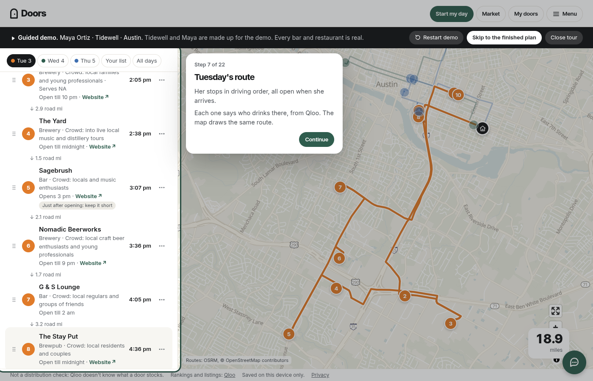
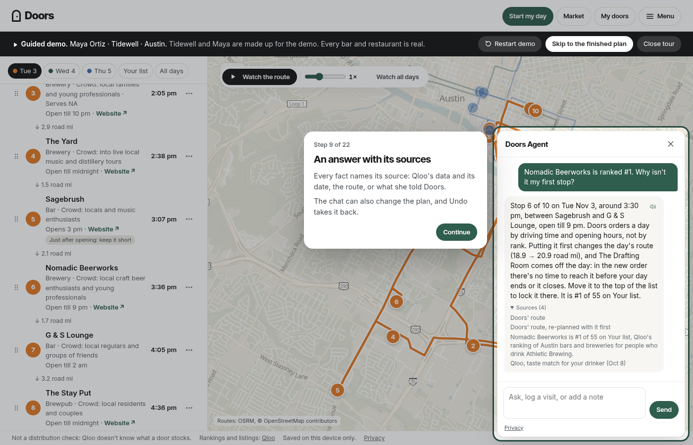

# Doors: plan a drink brand's first days in a new city

Doors plans a drink brand's first days in a new city. It ranks the city's bars and restaurants for
your drinker on Qloo's taste graph, routes the open ones into days a rep can drive, drafts what to say at each door,
and re-plans the days ahead as the rep logs visits; Doors Agent answers why a door is on the list. In the
demo, Nomadic Beerworks is Austin's best door for an Athletic Brewing drinker (#1 of 55), while popularity alone puts it
#17, so a map or a "best bars" list would send her somewhere else first.

**What's agentic.**
- **Doors Agent**, a chat on the plan that acts on it. Ask why a door ranks where it does, compare two doors or ask
  about the city's crowd; or tell it "I have to finish by 4", "skip the next one", "make my opener shorter", "done at
  Fora, back Thursday at 3": it re-plans, edits the talking point, logs the visit or remembers the correction. It also
  briefs a door, preps the day, drafts a follow-up and plans the next trip. It chooses among 13 tools and code checks
  every call against the plan before anything changes (the door is on the plan, the date is real, the talking point
  passes the same word rules); Undo takes back the last answer's changes. Every fact in an answer carries its source. Before a model reads
  a typed message or a note, Doors replaces the names it knows or finds (the rep's, her saved contacts', a name beside "talked
  to" or "the manager is") with "the contact", replaces phone numbers and emails, and leaves out what a note says about
  a person (age, origin, religion, health and the like). These are pattern checks, so a detail they miss goes as written. Voice is different: a spoken clip is transcribed as
  said, and a read-aloud is sent the words on screen.
  It runs on Anthropic's Claude Haiku. A question about a door's menu, events or news
  goes to Claude Sonnet with web search, and the pages it used are linked under the answer. When Claude can't answer,
  Workers AI's Llama 3.3 and then Gemini's free tier do; when no model can, Doors' own rules answer what code alone
  can.
- **A trade brief for the city.** When a plan is built, Doors asks Claude, with web search, for a short sourced brief
  on the drink category in that city (the trade, the state's trade-practice rules, the scene). Only the category and
  the city are sent; the brief is shared by everyone who plans that category there, and Doors Agent answers from it.
- **Drive mode.** Start my day turns the plan into one door at a time and one big **Log visit**. The rep says "liked it,
  back Thursday at 3, hesitant about price"; Doors files the outcome, the follow-up and her words, reads them back and
  moves to the next door. If the network or the model fails, the same rules read it on the device.
- **The live run.** For any brand in any US city, the Worker plans and makes its own ~20 Qloo calls, step by step on
  screen.

**What's culturally grounded.** Who drinks in each door comes from Qloo: taste affinity for the rep's drinker, Qloo's
profile of the door's crowd, its door tags (drinks, menu, time of day). The rep adds what Qloo can't know: her doors,
her ask, how each visit went, her corrections. When two of them disagree, Doors keeps one order, strongest first:

1. your correction ("say fridge, not cooler")
2. what you told Doors (your profile, your notes)
3. what you did (a logged visit)
4. Qloo's data
5. a guess
6. Doors' template

So a return visit talks
like one (it asks for the person she met and answers the objection she heard), and **Your rules** ("never say
cooler", "say fridge, not cooler") apply on every stop. No persona prompt, and nothing is inferred about anyone's
demographics.

**How it was checked** (a proof harness, `node scripts/proof.mjs`: 12 scenarios including NA, soft drinks, a rep with
no drinker brand and small cities; offline, 0 live Qloo calls; re-run on the frozen build with every stop's talking
points written again by the app's own call). Code checks: one input swapped (city or drinker brand) gave visibly
different, appropriate plans in 5 of 5 pairs; the same input gave identical output 12 of 12; 14 of 14 inputs changed a
decision when removed; swapping demographic labels changed nothing in 36 of 36; an empty input asked or stayed neutral
in 74 of 74; a correction persisted and won in 72 of 72. Then a blind screen by a different model (Claude Sonnet, which
also writes the talking points; the rest of a card is Doors' templates). It preferred Doors over the same app with its
cultural inputs off in 12 of 12 scenarios. A first judge that was asked to pick A or B picked whichever output came
second in 20 of 24 asks and in 24 of 24 return asks, so it was replaced, before any new verdict was seen, by one that
scores each output on its own (1–5 at what is said, the note and the doors chosen, its reasons written first), asked
fresh in both orders. Against the same city's doors ordered by popularity it scored Doors higher in 10 of 24 asks, the
popularity list in 9, with 5 ties (mean 9.0 against 9.0 of 15), and scored the second output higher in 13 of 24 asks:
even. Doors was ahead in six scenarios (all three mezcal ones, the Omaha hard seltzer, the Austin tequila one and the
NA brand planned from Liquid Death drinkers), the popularity list in five (both cider reps with no drinker brand, the
two NA brands planned from Athletic drinkers and the Boise canned water), one tie. The popularity list is planned with
the same week fill, so its first day also opens on its own top doors. It scored the card with memory higher in 23 of 24
return asks (mean 10.6 against 6.8 of 15, all 12 scenarios), and the second card higher in 13 of 24. An earlier run on
shorter cards, before the model wrote the talking points, read 17 of 24 and 11 of 12 with the pick judge; `docs/PROOF.md`
keeps both judges' rows.

Click **Watch the tour**: a guided tour of the real app in 22 short cards, no sign-up. It asks Doors why its #1-ranked door
isn't the first stop, shortens an opener, shows that stop's card before and after her visit, logs a visit in drive
mode and ends on the same brand in Boise. The tour's plan is baked (no Qloo, routing or plan-building call); on the web
Doors Agent and the voice are live in it, as in the app: Claude answers the chat, and drive mode's hands-free bar
listens and speaks (in the iPhone app's tour Doors' rules answer and the device's own voice reads). https://doors.oldjard.workers.dev · Code:
https://github.com/joshuawhite389/doors (MIT)

**Try it:** on the form, open **Try an example** (a made-up rep for each brand Doors already holds, in a city it
holds): Build is instant. Then plan your own: search any brand Qloo knows and pick it, type any US city ("Nashville,
TN"), an address or a pin for your start, your days, and Build. Doors' agent asks Qloo live, about 20 calls with its
steps on screen, and a brand and city someone has already run open at once.

**Why now:** nonalcoholic drinks grew 44.2% in bars and restaurants in the last year, against 18% in stores, and bars
and restaurants are now 31.1% of NA sales (NIQ data, The Spirits Business, Oct 14 2026:
https://www.thespiritsbusiness.com/2026/10/us-non-alc-sales-hit-1bn-in-off-premise/). The number of companies making
NA beer went from 91 to 213 between 2021 and 2025, and their brands from 173 to 484 (NIQ data, Brewers Association,
Jan 16 2026: https://www.brewersassociation.org/insights/the-state-of-non-alc/). Each new brand opens its markets the
same way: a founder or one rep, a few days, a list of doors. Taste data and agents only now let a tool pick those doors
by *drinker* rather than by menu.

## What it does

You build a profile: your brand, what you make, which brands your drinker already buys (1–3), the city, which doors to
pitch (bars, breweries, restaurants with a bar, wine bars, cafés for NA), where your day starts, the days and hours you
have, and the time at each door. Doors then:

- **Ranks the city for your drinker: Your list.** Every bar and restaurant Qloo ranks for people who drink like your
  drinker, filtered to the doors you pitch, best first. Each door says in words why it is there (Qloo's profile of its crowd), and Qloo's
  own rank (for example #6 of 55 Austin bars and breweries for people who drink Athletic Brewing) is one
  tap away, under Why this door. Each row says which day it landed on, or why it didn't.
- **Plans your days: best doors first, then the drive.** Each week takes your best-ranked doors first. Within it,
  each day is a loop from your start and back, and a door goes on a day only if it is worth the driving it adds
  (15 minutes, more for a top door); every door is open when you arrive (by each venue's own listed hours). Want fewer? "Most doors a day" in the city's settings. Miles are real roads ("road mi"). The route
  draws itself, with the camera following it like someone giving directions.
- **Prepares every door.** Open a stop: when you arrive, why this door (from Qloo's profile of its crowd), a drafted
  note ready to copy, email or text, and talking points: who to ask for and when (Doors' own), then the opener, the
  angle (the one thing about this door that changes the pitch), the line for the buyer, questions, points to make and
  likely pushback, and the drafted message itself, that Claude Sonnet writes for that door from Qloo's facts about it, each
  line checked against those facts (the standard set when it can't; no door says a model wrote it, the privacy page
  does), and your ask.
- **Re-plans as you go.** Log visit on a door (Interested · Follow up · Talked to someone else · Not interested; the
  Follow up button carries its date, "Follow up Wed Oct 28", and Add details picks another), or from its ⋯ menu mark it Not a fit or Already know them. Later days re-plan around it; missed doors carry forward; a follow-up is pinned to its date; your
  own contacts are pinned ahead of ranked doors. Every change can be undone.
- **Answers and acts: Doors Agent.** "Why isn't my #1-ranked door my first stop?" gets the trade in plain words and Qloo's rank, each
  fact with its source and the date Qloo was asked. "Make my opener shorter", "skip the next one", "I have to finish by
  4", "done at Fora, back Thursday at 3, hesitant about price" each change the plan through one checked tool call, with
  Undo.
- **Drive mode.** Start my day: one door at a time, what to say right under its name, then why now, and Navigate. Log visit listens (or takes a
  few typed words), reads back what it understood, saves it and shows the next door. Running late? Pick +15 min, +30 min or
  +1 hour: it names the doors that won't fit and offers a day they fit on; when no day has room, it offers to skip them (back
  on Your list) or end the day. Add to Home Screen installs it as an app that opens the plan.
- **Remembers.** A return visit greets the person she met and leads with the objection she heard; a text message is
  short and an email is not; Your rules (never say a word, or say one word instead of another), set once in Edit my brand,
  hold on every stop of the brand, every city.
- **Exports** the plan as CSV, the drafted messages as text and a printable call sheet.

**The iPhone app.** Doors is also a native iPhone app (React Native with Expo, `app-mobile/`), not a web view: home,
the brand form with Qloo search, the building steps, the plan with its map, days, Your list and All days, every stop with
its sources, the visit sheet, Market, Export, Doors Agent, drive mode and the guided demo. It runs the web app's
own planner code (`public/lib`) against the same Worker, keeps plans on the phone, and logs a visit with Doors' rules
when it is offline or no model can answer. The full app was tested on iOS simulators (a Release build), including a
live run for a new brand and city, and runs as a signed Release build on two real iPhones (every screen tapped on an
iPhone XS; the owner's own use on an iPhone 17). It is not in
the App Store, so judges use the web app, where every one of these screens also works.

The guided demo walks through all of this on a made-up brand, Tidewell (a non-alcoholic hazy IPA), over three
afternoons in Austin (Tuesday 10 doors, Wednesday 6, Thursday 6), with real venues and real road times. Its last card
ends on the same brand in Boise, side by side: Athletic Brewing drinkers' #1 door in Austin (Nomadic Beerworks) beside Boise's
(Lost Grove Brewing), each with its rank on Qloo's list beside where popularity alone puts it (#1 of 55 vs #17 in Austin, #1 of 49 vs #3 in Boise),
how many sister doors it has (17 sister doors in Austin, 14 in Boise) and the start of Qloo's own words about its crowd.

## Who it's for, and who pays

The founder or head of sales at an emerging NA beer, RTD, craft spirits or functional-drink brand opening its next
market, and the distributor rep assigned to it. **Intended price** (it is free during the hackathon): **$399 per brand
per market per month**, or **$99 per rep seat per month**. We assume a launch is 2–5 markets.

**Who we can count.** In the US: 213 companies making NA beer, with 484 brands (Brewers Association, above); 2,131
active craft distillers (American Craft Spirits Association data, Global Drinks Intel, Oct 7 2026:
https://drinks-intel.com/spirits/us-craft-distillery-closures-outpace-openings-for-first-time-in-2025-data/); 9,578
craft breweries (Brewers Association, 2025:
https://www.brewersassociation.org/statistics-and-data/national-beer-stats/); plus the RTD and functional brands
nobody counts in one place. That counts who it's for, not who would buy, so we print no dollar figure. The unit is one
brand opening one market at $399 a month.

**Why $399.** A founder who hires someone to make sure the distributor sells the beer is "talking about having to pay
somebody $50-60,000" (Rob Lutz, founder, StormBreaker Brewing; Brewer Magazine, Jan 25 2024:
https://thebrewermagazine.com/keys-to-remember-in-self-distribution/). Over 250 working days that is about $200–240 a
day, so $399 a market a month is about two rep-days. Doors pays for itself if it saves two days a month, in planning
the route, in drive time, and in skipping doors whose regulars don't drink like the brand's drinkers. We have not measured whether it saves those days or wins more
accounts.

**Traction:** zero customers; Doors is free during the hackathon.

## Inspiration

An emerging drink brand opening a new city has no sales there, no menu presence and no distributor attention. The
founder and one distributor rep get a few days to walk into bars and restaurants, and they pick the doors from a
spreadsheet, a broker's say-so and the doors everyone already knows. The tools that exist read menus and depletion
data: they tell you who already pours your category. Nothing tells you which doors are full of the people who drink
you before anyone in that city pours anything. Qloo's taste graph knows which venues' regulars look like a brand's
drinkers. Doors turns that into the days a rep actually walks.

**The problem, in the trade's words.** These are published words from people in the trade, about the problem. None of
them has seen Doors.

- "Reps have hundreds—sometimes thousands—of brands in their portfolio. … you are not their priority until you
  actively make yourself one." Gary Schneidkraut, who spent most of a decade as a rep at Empire Merchants (Park
  Street, Sep 3 2026: https://www.parkstreet.com/how-craft-spirit-brands-win-distributor-rep-attention/)
- "Distributors are fulfillment houses. The selling has to be initiated by your own resources." The American Craft
  Spirits Association's conference guidance, quoted by the consultant Rob Weir, who estimates a distributor rep has
  "approximately 6 to 12 minutes of active selling time per brand per week" (Mar 21 2026:
  https://robweir.substack.com/p/the-broken-coin-part-1-distribution)
- "If you don't know how your brand will fit with the account, it will be a wasted visit." Sandra Lee, Badger Bevs
  (SevenFifty Daily, Aug 19 2024: https://daily.sevenfifty.com/how-wine-reps-can-land-new-restaurant-and-retail-accounts/)

Doors ranks a city's bars and restaurants by how closely their regulars match the brand's drinkers, so the founder or
rep can spend those few days at the doors most likely to fit.

## How it uses Qloo

A map shows you every bar near you. It can't tell you which ones are full of your drinker. Qloo can: Doors asks the
Insights API for places (`filter.type=urn:entity:place`) with your drinker's brand as the signal
(`signal.interests.entities`), the city as `filter.location.query`, bar and restaurant tags (`filter.tags`,
`operator.filter.tags=union`), a popularity cap (`filter.popularity.max=0.9`) so the list is reachable doors rather
than the city's most popular, and `feature.explainability=true`, three pages of 50. Then:

- **Several drinker brands** merge their ranked lists in turn into one Your list.
- **A door as the drinker:** a venue id as the signal (with the venue excluded) finds the doors whose regulars look
  like the regulars of a bar where you already win (the Parson's Chicken & Fish preset).
- **Sister doors:** a venue as the signal, other places in the city as the answer, shown on a stop (precomputed for
  the top doors of every list).
- **Any brand × any city, live.** For a brand or city Doors doesn't hold, its agent runs these calls itself: it
  resolves the brand, ranks the city's bars and restaurants for its drinkers (3 pages), re-ranks by age, checks the
  most popular doors, finds sister doors and door sounds, then drafts the notes. About 20 Qloo calls, streamed to the page
  as steps, and kept server-side, so a repeat is free.
- **Search** resolves brands (the name typed first, then drinks by Qloo's tags; a name never resolves to another brand) and finds a venue by name when a rep adds
  their own door (1 call per click).
- **Qloo's profile of each door** (its crowd and ambience text) is the source of "Why this door". Qloo's drinks, menu,
  interests and ambience tags pick the angle (the line for the buyer and the rep's prep line); the crowd text picks the
  daytime and sports angles. Nothing said out loud or sent describes the crowd: the opener is the rep's intro and who buys. Artist lists from the city and the brand keep artist names out of every drafted line.
- **Brands that share her doors**: in Market, the other brand whose drinkers share the most of her top 50 doors
  ("Many of your best doors are also favorites of LaCroix drinkers in Austin.") and the next two by name, from the
  overlap of Qloo's top-50 lists, said in words.

Doors adds filtering, scheduling and wording. Its planner fills each week from the top of the list, then routes the
week's days for the least driving, and it never shows that trade as a score. Every rank on the plan's screens is a door's place on
Your list: Qloo's order after Doors keeps the door types you pitch, or the drinker brands' lists taken in turn when you name several.

Redacted request → result: `GET /v2/insights?filter.type=urn:entity:place&signal.interests.entities=<Athletic Brewing
id>&filter.location.query=Austin&filter.tags=<bar and restaurant tags>&operator.filter.tags=union&filter.popularity.max=0.9&take=50&page=1`
→ 50 places with `query.affinity`, hours, phone, photo and crowd text → after the Door types, "55 Austin bars and
breweries" → Tuesday 1–6 pm from East Austin: 10 doors in a 19 road-mile loop, Nomadic Beerworks (#1) among them,
each open on arrival.

## How the agent plans, drafts and re-plans

Two kinds of agent, said plainly. The planner below is a scripted planner-executor: a fixed tool set, no model
choosing. Doors Agent and drive mode's Log visit are where a model chooses: Claude (Haiku; Sonnet for a web question) picks
among 13 tools in the chat (Log visit gets one, log_visit), code validates every call against the plan the client sent (the Worker keeps no plan and no
conversation), and nothing invalid reaches the plan. A turn takes a few model steps, each cut at 8 seconds, with up
to 2 web searches a request; caps per visitor (20 turns in 10 minutes, 60 a day, 15 web searches a day, counted by each
server instance, plus 10 turns a minute at Cloudflare's edge) and a site-wide $30-a-day spend cap on Claude, past
which Workers AI and Gemini's free tier answer. When a cap or every model stops it, the chat says so and Doors' own
rules still answer what code alone can: why a door ranks where it does, skip a door, finish by a time, log a visit.

- **It plans the calls.** For a brand or city it doesn't hold, the agent decides and makes about 20 Qloo calls on
  Build (the live agentic path), streams each step to the page, and keeps the result server-side so the same brand and
  city cost nothing again. The Examples and the guided demo cost zero: they run on the precompute, a cache of real
  Qloo calls (private server-side caching, allowed by Qloo's rule in the hackathon's Discord on Oct 6). Search and Add a door cost one
  call, only on an explicit click. Popular runs are cached from real Qloo calls: 15 popular US drink brands across
  14 big cities, run ahead of time by the same agent, so those plans open at once. The Worker holds the keys and
  counts every call against the build's ceiling (34,000 a calendar month, keeping 16,000 of the key's 50,000 unspent;
  Qloo's month rolls, resetting around Nov 20, at 10 calls a second). New runs have a site-wide daily ceiling spread
  over the days to Nov 16, and each visitor (an IPv4 address or an IPv6 /64) starts at most 5 a day; runs and
  searches only come from Doors' own page. Near the ceiling new runs rest, and the page says so plainly and offers
  the Examples and the runs already made instead of an error.
- **It ranks, routes and drafts.** It filters Qloo's list to the doors you pitch, builds each day as a loop from your
  start, values a door at 15 minutes of loop driving (more for a top door), keeps only doors open when you arrive (waiting up
  to 20 minutes for one to open), moves a door to whichever day's loop passes nearest, and drafts the note and talking
  points for every door. Every ranked door it leaves off has a reason ("opens 5 pm, after your window", "adds 22 min
  of driving to Wednesday").
- **It re-plans from what the rep reports.** Visited, not a fit, already know them, follow up on Thursday: today keeps
  its order, later days take back their doors first and fill the gap, missed doors carry forward, a follow-up is
  pinned to its date (or the next day it fits, and the plan says so), and a toast says exactly what moved.

## How we built it

- Vanilla JS ES modules, no build step, no dependencies; a Cloudflare Worker with static assets; MapLibre GL on
  OpenFreeMap tiles, with self-hosted Protomaps files and OSM raster as fallbacks.
- One pure planner (`schedule.js`), measured on 161 plans (`scripts/sweep-routing.mjs`): 7.4 doors and 41 minutes
  of loop driving a day, mean rank #27, the #1 door kept in 81% of plans. Filling each week by rank first costs
  driving: planned the old way (by area), the same plans drive 30 minutes a day for 7.8 doors, at mean rank #36 and
  78% for the #1 door. A median plan takes about 15 ms. A 128-plan sweep in the tests checks that every stop is open
  on arrival, under 3% of stops come after a leg over 5 mi, and marking a door "not a fit" leaves other days alone
  (0 of 1,280 other days changed over 320 marks; the test allows 20%).
- The Qloo precompute (a cache of real Qloo calls, private and server-side) ran once, with every raw response cached
  and every call written to a ledger; with development, the live-run tests, the pre-warm of 114 popular runs and the per-door enrichment of
  every route door (7,994) and the saved runs' fill (14,303), 27,795 calls in
  October against the build's own ceiling of 34,000 a month.
- The live agent is the same code path on the Worker for any brand and city, streamed to the page as steps; each
  run is kept in KV by drinker and city.
- The demo runs the real planner on road times baked once from the public OSRM server (≤ 10 requests a run), so it
  makes zero live calls and still is the product, not a recording.
- An offline test suite (`npm test`) covering the planner, the stop, the Worker and its guards, the demo bake and an
  honesty test that scans the web app's shipped code and data text (`public/`) for banned claims, checks the
  required labels, and builds real stops in all four cities to check what a stop shows.

## Challenges

- **Days a human would drive.** Ranking alone sent a rep across the metro for one good door. Reviewing the routes, the
  owner put it plainly: a door 15 minutes away from your start "is actually 30", and one on the way home is an easy
  yes. So the planner went driving first: each day a loop home, a door worth about 15 minutes of driving. That cut
  loop driving (39.8 to 24 minutes a day on that build), but a rep's best doors could land in week three. So each week
  now takes the best-ranked doors first and routes only those: week one gets the top of the list, for some more
  driving (41 minutes of loop a day today, with more weight on rank), and a day still skips a better-ranked door far
  off its loop, and Your list says so.
- **Doors that open late.** A 4 pm opener on a 2–6 pm window needs earlier doors to reach it. A short wait (≤ 20 min)
  fixed most cases without inventing a schedule no rep would follow.
- **Re-plans that don't reshuffle.** Marking one door used to rearrange the whole week. Later days now keep their
  doors first.
- **Honest words.** Qloo doesn't know what a door stocks, so nothing says it does. The crowd text is "Qloo's profile
  of this door", never the venue's own listing. Model-drafted lines are labelled, category facts come from a fixed,
  sourced list, and every distance says whether it is road or estimated.
- **Routing keys.** OpenRouteService's sign-up was broken for most of the build, so everything was built to work on a
  labelled straight-line estimate first; once the key arrived, plans switched to real roads with no page change. The
  demo uses roads baked offline from OSRM, so it never depends on a live routing service.

## Accomplishments

- A landing page that says who it's for, and a guided demo inside the real app that shows the whole loop with zero
  live calls.
- A plan a rep could actually drive, with a reason for every door it leaves off.
- Every rank says which list it comes from, and every distance says whether it is road or estimated.

## What we learned

- Brand-to-place affinity separates brands within a category; the popularity cap keeps lists specific.
- A venue works as a signal: finding doors like one that already pours you is one call.
- Planner quality is mostly about which drives a rep would refuse to make, more than about the best rank.

## What's next

- The iPhone app (above) through TestFlight and into the App Store, once the Worker is published: the launch build
  (https only, no local-network access) is scripted and checked, and nothing is uploaded yet.

- A second road-routing provider behind the same Worker endpoints, for headroom past ORS's free limits.
- Visit outcomes fed back: "doors like the ones that said yes".

## Limits

- **Not a distribution check.** Qloo doesn't know what a door stocks. Doors shows doors whose regulars drink like
  yours, whether or not they pour you yet.
- Saved on this device only: no accounts.
- Miles and drive times come from OpenRouteService; if it is unavailable or over its free limits, they fall back to a
  labelled estimate (straight-line × 1.35 at 18 mph). The demo and landing hero use roads baked from OSRM.
- Hours are each venue's Qloo listing, captured 2026-10-08; unparseable hours say "hours unverified".
- A city Doors doesn't hold is thinner: an address or a pin for the start (no starting-point buttons), template Why
  this door lines beyond the agent's ~12 route doors, sister doors and music with the run for its top doors only (any
  other door has a button that asks Qloo, ≤3 calls), and no city base for the
  comparisons in Market.
- **Doors' Claude calls are capped at $30 a day for the whole site** (Agent turns, web searches, trade briefs, the
  Day done polish). Past that, or when Claude fails, Workers AI's free tier
  (about 90 turns a day) and then Gemini's free tier answer, and when those are out, Doors' rules do, and the chat says
  so. Caps: 20 turns per visitor in 10 minutes and 60 a day, counted by each server instance, plus 10 a
  minute at Cloudflare's edge.
- **Voice** works in any browser: the browser's own speech recognition where it works (Chrome, Safari), else a short
  clip to Cloudflare Workers AI; Log visit also takes a few typed words or a tap. A weekday ("back Thursday") means the next one after today; say a date for further out.
- **Cultural grounding is checked by code and screened by a model, not yet judged by people**: no rep or founder has
  rated it. The city-swap overlap of 0 is trivially true (another city
  has other doors); the substance there is the appropriateness checks.
- Qloo reads some city names as states ("New York, NY"); Doors stops that run after one call and asks for the city
  itself ("New York City").

## Built with

Qloo Insights API · Anthropic Claude (Haiku and Sonnet, with web search: Doors Agent and the trade brief) · Cloudflare
Workers · Workers AI (Llama: the chat's fallback; Whisper and Deepgram Aura-2: voice) · Gemini (free tier: offline
drafting, the chat's last fallback) · MapLibre GL · OpenFreeMap · Protomaps · OpenStreetMap · OSRM (offline) ·
OpenRouteService · Web Speech API · React Native / Expo (the iPhone app) · vanilla JavaScript

## Built-with-AI disclosure

Built by one person with Claude Code agents (planning, code, tests and reviews), with the owner deciding the product
and checking the claims. In the product, Gemini (`gemini-3.1-flash-lite`) drafted, offline, the Why this door lines
(crowd and room) for 2,217 doors from Qloo's profile text only; they are labelled "model-drafted" on every stop, and a
guard replaces any line that fails its checks with the template. (It also drafted an opener sentence for 650 doors; Doors
no longer shows those.) A live run asks the same model once to draft its route
doors' lines, labelled the same way.

Doors Agent and drive mode's Log visit call a model through the Worker on every turn: Anthropic's Claude Haiku
(claude-haiku-5-5; claude-sonnet-5-5 for a question that needs the web, with Anthropic's web search), then Workers AI
(llama-3.3-70b, then llama-3.1-8b), then Gemini's free tier (3.5-flash, 3-flash-preview, 3.1-flash-lite), then Doors'
own rules. Claude also writes the city's trade brief (category and city only) and, on the rep's tap, polishes the Day
done notes from the day's logged facts. Before the text is sent, Doors replaces the rep's and her saved contacts' names, and
names beside a role or a verb ("talked to Sam", "the manager is Priya"), with "the contact"; replaces phone numbers and
emails; and leaves out a clause that describes a person. These are pattern checks and can miss a detail; the privacy
page says so. The panel says: "Your messages go to Anthropic's Claude, or to Workers AI or Google Gemini when Claude can't answer, with names removed first; voice goes to Cloudflare." The panel
names the model that answered, and says so when Doors' rules answer because no model could; an answer Doors'
rules give before any model is asked carries no label. The facts under an answer are Qloo's data or what the rep said, each with its
source; a fact with no source is not shown. In the guided tour Doors' rules answer the chat and write the spoken note, and the device's own voice reads it: no
model call on the web or the iPhone app.

## Screenshots

`screenshots/v2/`, all from the guided tour and the plan it leaves behind, shot with no model connected, so Doors'
rules answer the chat in them: the landing; Tuesday's route; the week's three loops; what to say at the door; the week
re-planning after a visit; why a
door is on her list; Doors Agent with its sources open; Your rules in Edit my brand ("Never say near beer"); the same door
before and after her visit (1400 px); and the landing, a day, a stop, Doors Agent, drive mode's read-back after Log visit and the full-screen map with its
layer menu on a 390 px phone. `screenshots/v2/lead-landing.png` is the landing's example day at 3:2 (the Devpost lead image: Athletic
Brewing drinkers in Austin, Tuesday, ten doors, the #1 door's card), and `public/og.png` the link preview of the same day.
`screenshots/phone/iphone-app.png` is the native iPhone app on an iOS simulator (one plan, Tidewell in
Austin from the examples, not the tour; the simulator's clock set to that Tuesday, 3:30 pm).
